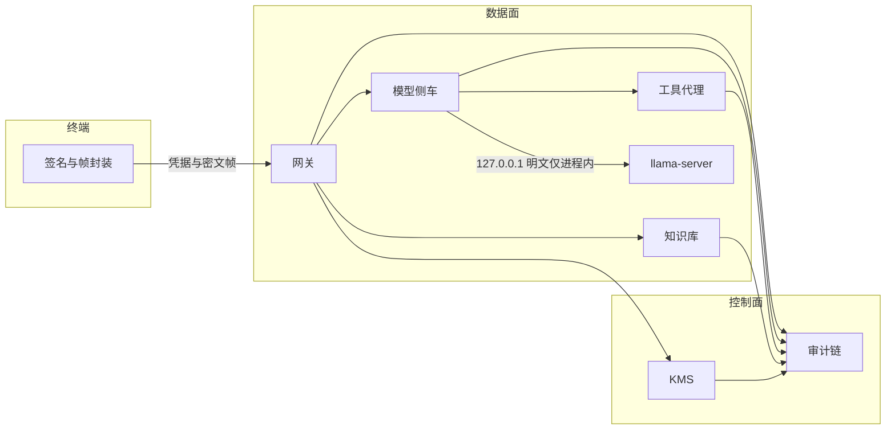
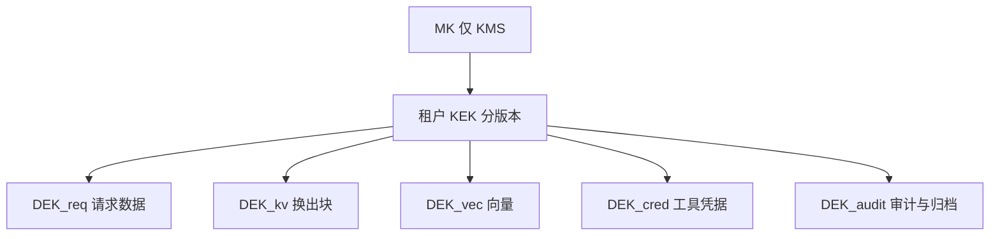

# A1-17 大模型推理数据全流程密码保护方案

| 项 | 内容 |
| --- | --- |
| 赛题 | 大模型推理数据全流程密码保护方案（A1-17） |
| 类型 | 密码应用技术 / 密码竞赛 |
| 依据 | GB/T 39786-2021；SM2 GB/T 32918；SM3 GB/T 32905；SM4 GB/T 32907；分组密码工作模式 GB/T 17964 |
| 状态 | 方案与实验大纲 |

## 1 工程要求指标

### 1.1 保护范围

一条可复现推理链路，覆盖数据的产生、传输、使用、缓存、存储、归档、审计。

链路节点：终端、网关、模型服务、知识库、第三方工具。外部链路加密不作为内部安全边界。

| 数据对象 | 产生位置 | 经过节点 |
| --- | --- | --- |
| 提示词 | 终端 | 网关、模型服务 |
| 检索内容 | 知识库 | 网关、模型服务 |
| 向量数据 | 知识库 | 知识库存储、网关 |
| 模型输出 | 模型服务 | 网关、终端 |
| 工具参数 | 模型服务 | 网关、工具代理 |
| 身份凭据 | 终端 / 签发方 | 网关及全部内部调用 |
| 审计日志 | 各节点 | 审计存储、归档 |

须闭合的威胁：内部接口窃听；跨租户数据串用；缓存与临时文件泄露；结果篡改；重放调用；备份副本失控；租户密钥未隔离；主密钥与数据密钥层级不清；轮换、吊销、恢复时新旧密钥状态不一致。

### 1.2 必达指标

| 编号 | 指标 | 门限 |
| --- | --- | --- |
| M1 | 连续推理请求数 | 1000 |
| M2 | 密码保护成功率 | ≥ 99.5% |
| M3 | 预置篡改请求识别 | 100% |
| M4 | 预置重放请求识别 | 100% |
| M5 | 附加时延合格比例 | ≥ 95% |
| M6 | 单次附加时延合格条件 | ≤ 未启用保护时延的 15%，或 ≤ 30 ms |
| M7 | 在线密钥测试次数 | ≥ 100 |
| M8 | 换钥成功率 | ≥ 99% |
| M9 | 换钥过程中合法请求成功率 | ≥ 99.5% |
| M10 | 凭据吊销生效时间 | ≤ 60 s |
| M11 | 吊销后旧凭据拒绝率 | 100% |

M5、M6 在同一软硬件、同一模型、同一请求集上比较保护开启与关闭。M3、M4 的样本不计入 M1 的 1000 次。

### 1.3 判定口径

密码保护成功：一次合法请求同时满足下列条件。

1. 凭据验签通过，且不在吊销集。
2. 时间窗与随机数重放检查通过。
3. 租户、角色、动作、对象类型授权通过。
4. 提示词、检索内容、工具参数在模型侧车解密并通过完整性校验。
5. 终端对模型输出的完整性校验通过。
6. 审计记录落盘，且与前一条记录的链式哈希衔接。

任一条失败即计为保护失败。成功率 = 成功数 / 1000。

附加时延：同一条提示词成对测量。Δ = t_on − t_off。该请求合格当且仅当 Δ ≤ 0.15 × t_off 或 Δ ≤ 30 ms。合格比例以保护开启的 1000 次为分母。服务已加载模型之后的预热请求不进入分母。

换钥成功：同一次持久化事务内，新版本状态变为 Active，旧 Active 变为 DecryptOnly，租户当前写版本指针指向新版本。三者缺一计为换钥失败。

换钥过程中的合法请求：换钥事务开始至旧版本进入 Retired 之前发出的、凭据有效的推理请求，按“密码保护成功”统计。

吊销：t0 为吊销操作提交成功时刻。在 (t0, t0+60 s] 内持旧凭据的访问全部拒绝。拒绝率以该区间内旧凭据请求为分母。

篡改或重放被识别：返回确定的拒绝码，且审计中存在对应检测事件。接受明文或返回正常推理结果计为漏识别。

### 1.4 交付物

方案、可运行原型、攻击测试、测试环境说明、原始数据。原始数据至少包含：请求标识、起止时间、时延、保护开关、租户、密钥版本、结果码、提示词摘要、审计哈希。

## 1.5 本机环境与运行选型

### 1.5.1 实测

| 项 | 值 |
| --- | --- |
| GPU | NVIDIA GeForce RTX 5090，32607 MiB，驱动 591.86 |
| 推理程序 | `E:\qwen agent\llama-server.exe`（llama.cpp，附带 CUDA 动态库） |
| Python 基线 | `E:\AI\venvs\qwen-chat\Scripts\python.exe`，3.12.10 |
| 已装库 | torch 2.11.0+cu128，transformers 5.15.0，cryptography 50.0.0 |
| SM 算法包 | 当前基线环境未安装 |
| WSL | Ubuntu-22.04、Debian，状态均为 Stopped |

本机可直接加载的两类千问权重：

| 称呼 | 用途 | 路径 |
| --- | --- | --- |
| Qwen3.5-9B | 指标主测 | `E:\AI\models\llm\gguf\Qwen3.5-9B-abliterated\Qwen3.5-9B-abliterated-Q6_K.gguf`（7 359 259 040 字节） |
| Qwen3.5-9B 官方 HF | 备选，不进 1000 次时延 | `E:\AI\models\llm\hf\Qwen3.5-9B` |
| Qwen3.8-27B | 跨模型抽测 | `E:\AI\models\llm\gguf\Qwen3.8-27B\Qwen3.8-27B-UD-Q5_K_XL.gguf` |
| Qwen3.8-27B FP8 | 不进连续压测 | `E:\AI\models\llm\hf\Qwen3.8-27B-FP8`（权重大约 30.9 GB） |

llama.cpp 当前登记的活动模型为 `9b-abliterated`。

### 1.5.2 选型

指标实验在 Windows 本机执行。推理进程为 `llama-server.exe`，只监听 `127.0.0.1`。密码原型为独立 Python 进程，虚拟环境从 Python 3.12.10 建立，增补 SM2、SM3、SM4 实现。

主测模型为 Qwen3.5-9B 的 Q6_K GGUF。该权重大约 6.9 GiB，在 32 GB 显存上可常驻。Qwen3.8-27B 的 Q5_K_XL 只做短序列功能抽测，不承担 M1–M6。27B FP8 与 35B-A3B-FP8 不进入本实验。

指标实例的上下文长度为 2048，关闭思考模式，`max_tokens = 32`。关闭思考模式的目的，是使附加时延的主体落在密码处理上，而不是落在可变长度的思维链上。

WSL 不参与运行。现有 `E:\qwen agent` 局域网聊天代理不接入原型。原型与该代理分端口、分进程。

### 1.5.3 运行边界

模型进程内的活动张量保持明文，供 llama.cpp 直接计算。离开该进程的提示词、检索内容、输出、KV 换出块、临时文件和备份均为密文。`llama-server` 不修改。加解密放在模型侧车。

## 2 实现方案

### 2.1 算法与报文

| 用途 | 算法 |
| --- | --- |
| 身份签名、验签 | SM2 |
| 摘要、链式审计 | SM3 |
| 数据加密 | SM4-CTR |
| 完整性 | HMAC-SM3，先加密后计算 MAC |
| 密钥派生 | 以 SM3 为 PRF 的 KDF，信息字段区分用途 |
| 数据密钥封装 | SM4 密钥包装，包装密钥为当前 Active 的租户 KEK |

明文帧：

```
version | tenant_id | obj_type | key_ver | req_id | ts | nonce | ct | mac
```

关联数据 AAD 为 `version || tenant_id || obj_type || key_ver || req_id || ts || nonce`。MAC 覆盖 AAD 与密文。`obj_type` 取值：`prompt`、`retrieval`、`vector`、`output`、`tool_arg`、`kv_block`、`credential_blob`、`audit`、`archive`。

随机数 128 bit，由发送方生成。接收方拒绝时间窗外的帧，并拒绝已出现过的 `(tenant_id, nonce)`。时间窗取 60 s。

### 2.2 密钥层次与状态

```
MK
└─ KEK(tenant, version)
   ├─ DEK_req      单次请求的提示词、检索内容、工具参数、模型输出
   ├─ DEK_kv       该租户 KV 换出块与临时文件
   ├─ DEK_vec      向量与知识库对象
   ├─ DEK_cred     工具凭据
   └─ DEK_audit    审计与归档
```

MK 只存在于 KMS 进程，用于包装 KEK。业务进程只在单次调用中接触解包后的 DEK，调用结束即从内存清除。

KEK 状态：`PreActive`、`Active`、`DecryptOnly`、`Retired`、`Revoked`。

| 规则 | 内容 |
| --- | --- |
| 写 | 只使用该租户唯一的 Active KEK |
| 读 | 先 Active，再按版本号降序尝试 DecryptOnly |
| 禁止 | Revoked 与 Retired 不参与包装或解包 |
| 请求绑定 | 请求受理时固定 `key_ver`，该请求中途不改绑 |
| 原子性 | 新版本置 Active、旧版本置 DecryptOnly、写指针更新，三者同一事务 |
| 恢复 | 备份导入后进入 DecryptOnly；已 Revoked 的版本不可被恢复为可用 |

每个租户的 KEK 相互独立。已知一个租户的 KEK 不能导出另一租户的 DEK。

### 2.3 模块

#### 2.3.1 身份鉴别

终端持有 SM2 签名密钥，KMS 登记对应公钥、租户和角色。登录时网关发出 128 bit 挑战，终端对 `challenge || tenant_id || ts` 签名。网关验签后签发访问凭据。

访问凭据字段：`tenant_id`、`sub`、`roles`、`iat`、`exp`、`jti`、`sign`。签名算法 SM2。有效期不大于 60 s。凭据内不放置 MK、KEK、DEK。

内部服务调用携带同一凭据。模型侧车、知识库、工具代理各自验签，不信任来自网关的明文身份声明。

#### 2.3.2 鉴权

授权元组：`(tenant_id, role, action, obj_type)`。动作包括 `infer`、`retrieve`、`tool_call`、`audit_read`、`key_rotate`、`key_revoke`。

判定点在网关。知识库和工具代理复验 `tenant_id` 与动作。审计读取权限与推理权限分离，持有推理凭据不能读取其他租户审计，也不能解密审计中不存在的明文业务字段。

#### 2.3.3 令牌与业务数据加密

此处令牌指两类对象。

访问凭据按 2.3.1 签名，不加密业务数据。

推理数据在进入模型前保持密文。终端用本次 `DEK_req` 加密提示词。网关解密仅用于授权检查所需的最小元数据；转发至模型侧车时重新封装为侧车可解的帧，AAD 绑定 `req_id` 与 `tenant_id`。模型输出由侧车加密，终端用同一 `DEK_req` 校验 MAC 后解密。MAC 失败则丢弃输出，计为篡改识别。

工具参数使用同一请求的 `DEK_req`，`obj_type = tool_arg`。工具凭据不进入提示词，也不进入工具参数明文。

#### 2.3.4 KV Cache

活动 KV 留在模型进程地址空间，供当前请求解码。缓存键由模型侧车在鉴权之后计算：

```
cache_key = SM3(tenant_id || salt || prefix_hash)
```

`salt` 由 KMS 按租户保存，侧车读取。客户端不提交 `salt`。相同提示词在不同租户下得到不同 `cache_key`，禁止跨租户命中。

KV 换出到主机文件、临时文件或备份时，按固定块使用 `DEK_kv` 加密，`obj_type = kv_block`。块 AAD 含 `tenant_id`、`cache_key`、块序号、`key_ver`。请求结束或租户会话关闭后，清除该请求的内存 DEK。磁盘上只保留密文块。

逐 token 对显存 KV 做 SM4 不纳入热路径。该项若放入逐 token 路径，附加时延将越过 M6。

#### 2.3.5 向量与检索

知识条目和向量以 `DEK_vec` 加密后存放，AAD 含 `tenant_id` 与文档标识。查询向量在终端到知识库的路径上按 `retrieval` 帧加密。

检索结果以 `DEK_req` 重新封装后进入模型侧车，不把知识库存储密钥暴露给模型进程。索引键使用 `SM3(tenant_id || doc_id)`，索引中不存放提示词明文。

原型知识库为本地加密文件库，规模满足链路复现即可。

#### 2.3.6 工具凭据与第三方工具

工具凭据用 `DEK_cred` 加密，存放于工具代理。模型只输出工具名和业务参数。工具代理验签并检查 `tool_call` 权限后，在代理进程内解密凭据、调用本地模拟工具、立即清除凭据副本。

模拟工具为进程内固定应答，用于证明凭据未进入模型请求体。检查方法：记录侧车发往 `llama-server` 的请求体，确认其中不含凭据明文。

#### 2.3.7 传输

终端、网关、知识库、模型侧车、工具代理之间的业务帧均为 2.1 的密文帧。`llama-server` 只接受来自本机侧车的回环连接。

窃听检测样本在网关与侧车之间抓取。抓取结果应为密文帧；修改 MAC 或密文的一字节后，接收方必须拒绝。

#### 2.3.8 缓存、临时文件、存储与归档

临时文件目录固定为实验目录下的 `var/tmp`。写入前加密，文件名使用随机标识，不使用提示词原文。请求正常结束、失败结束或进程退出清理例程均删除这些文件。

归档对象使用归档时刻的 `DEK_audit` 或 `DEK_vec` 加密，密钥版本写入对象头。备份文件与在线文件使用同一帧格式。备份恢复只通过 KMS 解包，不存在旁路明文导出。

`Revoked` 版本的 KEK 不能解开其历史密文。历史可读性只保留到 `DecryptOnly`。进入 `Retired` 之前，仍需读取的对象先换封装到新 KEK。

#### 2.3.9 轮换、吊销、恢复

轮换步骤：

1. 生成 `KEK(tenant, v+1)`，状态 `PreActive`。
2. 事务提交：`v+1` 改为 `Active`，`v` 改为 `DecryptOnly`，写指针改为 `v+1`。
3. 新请求使用 `v+1` 包装新 DEK。已受理请求继续使用受理时的版本。
4. 待 `v` 上的在途请求结束后，将仍需保留的对象换封装到 `v+1`，再把 `v` 改为 `Retired`。

吊销步骤：

1. 将目标凭据 `jti` 写入吊销集，并记录 `t0`。
2. 若吊销的是密钥，则该版本立即改为 `Revoked`，写指针不得指向它。
3. 网关、侧车、知识库、工具代理每次验签前读取吊销集。吊销集以本地内存副本服务，刷新周期小于 60 s；验签失败或命中吊销集即拒绝。

恢复步骤：用 MK 解包离线封装的 KEK 备份，导入为 `DecryptOnly`。导入事务不得把 `Revoked` 记录改回 `Active` 或 `DecryptOnly`。

#### 2.3.10 审计

审计记录字段：时间、`tenant_id`、`req_id`、动作、结果码、`obj_type`、`key_ver`、`jti`、对象摘要。记录不含提示词、输出、向量和凭据明文。

链式哈希：

```
hash_i = SM3(hash_{i-1} || canonical(record_i))
```

`canonical` 为固定字段顺序的字节编码。每 100 条用审计签名密钥做一次 SM2 签名检查点。验证时重算全链，任一环不一致即判定审计被篡改。

### 2.4 单次推理顺序

1. 终端完成 SM2 挑战应答，取得访问凭据。
2. 终端向 KMS 申请 `DEK_req` 的封装，用其加密提示词。
3. 网关验签、查吊销、查重放、查授权，固定 `key_ver`。
4. 知识库返回加密检索结果。
5. 模型侧车解密提示词与检索结果，计算租户缓存键，调用 `llama-server`，加密输出。
6. 若输出含工具调用，工具代理解密自身保管的凭据并执行模拟工具；工具结果按 `tool_arg` 帧返回侧车。
7. 终端校验输出 MAC 并解密。
8. 各节点追加审计。侧车删除临时块和内存 DEK。

### 2.5 时延预算

热路径只包含：SM2 验签一次、吊销集查找、随机数查找、提示词 SM4 一次、输出 SM4 一次、两次 HMAC-SM3、审计追加。对象长度为短提示词加 32 个生成 token 对应的文本。

KV 块加密、归档换封装、密钥生成放在热路径之外。M6 的设计目标是 1000 次中至少 95% 的 Δ ≤ 30 ms。

### 2.6 总览



密钥与数据对应关系：



## 3 实验

### 3.1 目录

实验根目录：`C:\Users\zhaoc\Desktop\密码`。

```
C:\Users\zhaoc\Desktop\密码\
├── A1-17-方案与实验大纲.md
├── env\
│   └── requirements.txt
├── src\
│   ├── common\          帧、SM4-CTR、HMAC-SM3、SM2、KDF
│   ├── kms\             层次密钥、状态事务、吊销集
│   ├── gateway\         鉴别、重放、授权、转发
│   ├── sidecar\         模型侧车、缓存键、临时块
│   ├── kb\              加密知识库
│   ├── toolproxy\       凭据隔离与模拟工具
│   └── audit\           链式日志与检查点
├── fixtures\
│   ├── tenants.json
│   ├── prompts-1000.jsonl
│   ├── kb-corpus.jsonl
│   └── attacks\
│       ├── tamper.jsonl
│       └── replay.jsonl
├── scripts\
│   ├── start_llama_metric.bat
│   ├── run_m1_m6.bat
│   ├── run_keys.bat
│   └── run_attacks.bat
├── tests\
│   ├── test_flow.py
│   ├── test_attacks.py
│   ├── test_latency.py
│   └── test_keys.py
└── data\
    ├── raw\             提交用原始记录
    └── reports\         环境说明与汇总
```

运行时临时密文放在 `var\tmp`，不进入 `fixtures`。`var\tmp` 在每轮实验开始前清空。

### 3.2 大纲

| 编号 | 名称 | 内容 | 对应指标 | 通过标准 |
| --- | --- | --- | --- | --- |
| E0 | 环境固化 | 记录 OS、GPU、驱动、`llama-server` 路径、模型路径与字节数、Python 与密码库版本；启动指标实例：Qwen3.5-9B Q6_K，`-c 2048`，思考关闭 | 交付物 | `data/reports/env.md` 与原始日志可对应 |
| E1 | 链路闭合 | 2 个租户各 1 次请求，覆盖提示词、检索、向量、输出、工具参数、凭据、审计 | 范围 | 七类对象均有密文帧和审计事件；模型请求体无工具凭据明文 |
| E2 | 连续保护 | 1000 条固定提示词，保护开启，单进程顺序发送 | M1、M2 | 成功数 ≥ 995 |
| E3 | 时延成对 | 同一 1000 条先关闭保护再开启保护；模型保持常驻；前后各 20 次预热不计入 | M5、M6 | 合格比例 ≥ 95% |
| E4 | 篡改 | 对完整帧分别翻转密文 1 字节、翻转 MAC 1 字节、改 AAD 中的 `tenant_id` | M3 | 预置样本识别率 100% |
| E5 | 重放 | 重放捕获的合法帧；使用窗口外时间戳；重复使用同一随机数 | M4 | 预置样本识别率 100% |
| E6 | 换钥 | 在线换钥不少于 100 次；换钥期间并发合法推理 | M7、M8、M9 | 换钥成功 ≥ 99%；窗口内合法请求成功 ≥ 99.5% |
| E7 | 吊销 | 签发短凭据后吊销，自 t0 起 60 s 内持续用旧凭据访问 | M10、M11 | 60 s 内拒绝率 100% |
| E8 | 隔离与残留 | 两租户相同提示词比较缓存键；读取对方密文；检查 `var\tmp` 与备份文件 | 威胁闭合 | 缓存键不同；对方解包失败；临时目录与备份无提示词明文 |
| E9 | 密钥状态 | 轮换中途崩溃后重启，检查 Active 数量；尝试恢复已 Revoked 版本 | 状态一致 | 重启后每个租户至多一个 Active；Revoked 恢复被拒绝 |
| E10 | 跨模型抽测 | 同一网关改接 Qwen3.8-27B Q5_K_XL，20 次功能请求 | 链路无关性 | 保护成功；该组不替代 E2、E3 |
| E11 | 归档 | 汇总计数、失败样本、原始 jsonl | 交付物 | `data/raw` 与 `data/reports/summary.md` 齐全 |

E2 与 E3 使用同一 `prompts-1000.jsonl`。E4、E5 的样本单独存放，不混入这 1000 条。

E3 的关闭保护路径仍经过网关和侧车，密码运算改为直通，端口、进程数和模型参数保持不变。

### 3.3 原始记录字段

`req_id, t_start, t_end, latency_ms, mode, tenant_id, key_ver, jti, result, error_code, prompt_sha256, audit_hash`

换钥记录另存：`op_id, t_commit, tenant_id, old_ver, new_ver, state_ok, inflight_ok, inflight_total`。

吊销记录另存：`jti, t0, t_req, accepted`。`accepted = true` 即判定未达 M11。
